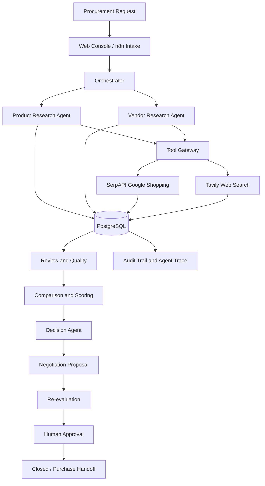

# BuyWise — Multi-Agent Procurement Automation

**An evidence-driven procurement platform built with n8n, Node.js, PostgreSQL, Docker, and optional LLM reasoning.**

BuyWise automates the procurement lifecycle, from product and vendor research to evidence validation, deterministic scoring, candidate selection, negotiation proposals, re-evaluation, and human approval.

The system combines specialized agents, a shared PostgreSQL database, a tool gateway for external providers, and an interactive procurement console. Every decision is backed by recorded evidence, and missing information is explicitly represented rather than fabricated.

> **Core principle: Real data only. No fabricated products, prices, vendors, reviews, or negotiation outcomes.**

---

## Table of Contents

- [Overview](#overview)
- [Key Features](#key-features)
- [Architecture](#architecture)
- [Procurement Workflow](#procurement-workflow)
- [Technology Stack](#technology-stack)
- [Data Integrity and Decision Rules](#data-integrity-and-decision-rules)
- [Getting Started](#getting-started)
- [Configuration](#configuration)
- [Running a Procurement](#running-a-procurement)
- [Web Console](#web-console)
- [Testing](#testing)
- [Security](#security)
- [Current Limitations](#current-limitations)
- [Project Structure](#project-structure)

---

## Overview

Traditional procurement involves manually searching for products, comparing vendors, verifying specifications, evaluating prices, and obtaining approvals. These activities can be time-consuming and difficult to audit.

BuyWise addresses this problem through a coordinated, multi-agent architecture that separates research, validation, scoring, decision-making, and approval into distinct stages.

The platform is designed to answer three important questions:

1. **What can we verify?** Collect product, vendor, pricing, and specification evidence from external sources.
2. **What can we conclude?** Evaluate eligible candidates using deterministic rules and only the evidence available.
3. **What should happen next?** Recommend proceeding, negotiating, conducting further research, or requesting human intervention.

When the evidence is insufficient, BuyWise reports the limitation instead of manufacturing a confident-looking answer.

### Example use case

A procurement team needs 15 business laptops with 16 GB RAM and a specified per-unit budget.

BuyWise can:

- Collect product listings and supporting research from configured providers.
- Identify merchants and retrieve prices when verified data is available.
- Validate mandatory specifications against supporting evidence.
- Evaluate source quality and completeness.
- Rank candidates using configurable scoring weights.
- Determine whether a candidate meets the decision requirements.
- Prepare an unsent negotiation proposal when the required evidence exists.
- Re-evaluate verified vendor responses and prepare an approval package.

The system does not guarantee that every request will produce an eligible purchase recommendation. A result such as `INSUFFICIENT_DATA` is intentional when the evidence does not support a reliable decision.

---

## Key Features

### Multi-agent orchestration

- Central procurement orchestrator built with n8n.
- Specialized product research and vendor research agents.
- Dedicated quality, comparison, scoring, decision, negotiation, re-evaluation, and approval stages.
- Persistent lifecycle transitions and agent coordination traces.
- Bounded retries and revision handling.

### Real provider integrations

- **SerpAPI Google Shopping:** commercial listings, merchants, prices, and available ratings.
- **Tavily:** web research, product specifications, official product pages, and supporting evidence.
- **PostgreSQL:** persistent procurement records, offers, evidence, decisions, approvals, and audit history.
- **Optional LLM reasoning:** advisory output through a configured OpenAI-compatible provider; deterministic rules remain authoritative.

Provider availability depends on valid credentials, network access, API quotas, and the quality of returned results.

### Evidence-based evaluation

- Mandatory specification validation.
- Source-quality classification.
- Attribution-gated product ratings.
- Configurable scoring weights.
- Missing-data-aware scoring and reproducible rankings.
- Explicit reasons for blocked decisions and missing evidence.

### Controlled negotiation and approval

- Negotiation proposals are generated only when verified vendor and offer details are available.
- Vendor communication is not automatically sent.
- Human-entered demonstration responses are explicitly labelled as simulated.
- Approval decisions require an authenticated actor and explicit action.
- Role-based authorization and separation-of-duties checks protect approval operations.

### Interactive procurement console

- Live dashboard backed by PostgreSQL.
- Procurement request creation and case tracking.
- Product, vendor, offer, and evidence exploration.
- Comparison and scoring views.
- Decision and negotiation workspaces.
- Re-evaluation and approval workflows.
- Agent execution traces and chronological audit history.
- Role-based access for administrators, requesters, procurement officers, approvers, and auditors.

---

## Architecture



### Architectural principles

- **Separation of responsibilities:** research, scoring, decision-making, and approval are distinct stages.
- **Persistent state:** procurement records and lifecycle transitions are stored in PostgreSQL.
- **Controlled tool access:** external data retrieval goes through dedicated adapters and gateway workflows.
- **Deterministic decisions:** eligibility, scoring, and approval gates do not depend on an LLM's opinion.
- **Traceability:** records retain supporting evidence, source URLs, timestamps, and decision reasons where available.
- **Human oversight:** negotiation sending and purchasing execution are not performed automatically.

---

## Procurement Workflow

BuyWise implements a controlled procurement lifecycle.

| Stage | Responsibility |
|---|---|
| Intake | Validate the request and identify missing or ambiguous requirements. |
| Product research | Discover relevant products and collect supporting specifications. |
| Vendor research | Identify merchants and retrieve commercial evidence. |
| Review and quality | Evaluate source quality, evidence completeness, and rating attribution. |
| Comparison | Compare eligible candidates using available criteria. |
| Scoring | Calculate reproducible scores using configured weights. |
| Decision | Determine whether to proceed, negotiate, research further, or stop. |
| Negotiation | Prepare a proposal when the required verified evidence exists. |
| Re-evaluation | Recalculate scores using verified revised terms or vendor responses. |
| Approval | Generate an approval package and record an explicit human decision. |
| Closure | Close the case following an authorized outcome. |
| Purchase handoff | Permit a handoff only when the required real approval conditions are satisfied. |

The lifecycle is enforced in both application code and PostgreSQL. Invalid state transitions are rejected and audited.

---

## Technology Stack

| Technology | Purpose |
|---|---|
| n8n | Workflow orchestration and agent coordination |
| Node.js | Tool adapters, validation, scoring, decision logic, and backend services |
| Express.js | Procurement console API and server |
| PostgreSQL | Persistent storage, lifecycle enforcement, and audit records |
| Docker Compose | Local infrastructure and service management |
| SerpAPI | Commercial product listings and available pricing evidence |
| Tavily | Web research and supporting source discovery |
| React | Interactive procurement interface |
| JavaScript / TypeScript | Backend tooling and frontend implementation |
| Python | Automated policy, schema, and integration validation |
| Optional OpenAI-compatible LLM | Advisory reasoning, when configured |

Ollama is optional and is not required for deterministic procurement processing. The system can operate without a configured LLM.

---

## Data Integrity and Decision Rules

BuyWise is designed to prioritize evidence quality over artificially complete results.

### 1. Missing data is never fabricated

Missing information is represented as `UNAVAILABLE`, `unavailable`, or `NULL`, depending on the field and storage contract.

The system does not invent:

- Product listings or merchant identities.
- Prices, currencies, or exchange rates.
- Product ratings or review counts.
- Vendor contact details.
- Delivery estimates or warranty terms.
- Vendor responses or negotiation outcomes.
- Human approval decisions.

### 2. Offers require verified commercial evidence

An offer is persisted only when the required evidence includes:

- Product identity.
- Merchant identity.
- Numeric price.
- Explicitly known currency.
- Source URL.

A search result alone does not guarantee that an eligible offer can be created.

### 3. Missing criteria are excluded from scoring

The scoring engine calculates the weighted average using criteria for which evidence is available:

`overall_score = sum(weight × score) / sum(available weights)`

Missing criteria are excluded from both the numerator and denominator rather than automatically receiving a zero.

The system records criteria used, missing criteria, and the effective weight total. If there is no valid scoring basis, the overall score remains `NULL`.

### 4. Currency is never guessed

Budget comparisons require verified prices in the same currency as the procurement budget. Currency conversion is not performed without a configured exchange-rate source.

### 5. Mandatory requirements are enforced

Mandatory specifications must have sufficient supporting evidence. Unknown or unverified mandatory requirements can block a candidate from proceeding.

### 6. Human approval is explicit

Approval requires an authenticated actor and an explicit outcome. A timeout, missing response, or generated proposal does not count as approval.

Demo responses remain marked as simulated and cannot authorize a real purchase handoff.

---

## Getting Started

### Prerequisites

Install the following:

- Docker Desktop with Docker Compose.
- Node.js and npm.
- Python 3.
- PostgreSQL client tools, if you want to inspect the database manually.
- API credentials for the providers you intend to use.

The commands below assume the repository is located at `D:\flexi` on Windows and that PowerShell is being used.

### 1. Configure environment variables

From the repository root:

```powershell
Copy-Item .env.example .env
```

Generate and configure a strong `POSTGRES_PASSWORD` and `N8N_ENCRYPTION_KEY` in `.env`.

Add provider keys only when available. Never commit `.env` to Git.

### 2. Start the infrastructure

```powershell
docker compose up -d postgres n8n
```

Check the n8n health endpoint:

```powershell
Invoke-WebRequest http://localhost:5678/healthz -UseBasicParsing
```

Ollama is intentionally omitted because it is not required for the deterministic pipeline.

### 3. Import n8n workflows

Open:

**http://localhost:5678**

Import the workflow JSON files in dependency order, where applicable:

1. `90-util-state-manager`
2. `92-util-tool-gateway`
3. `93-util-logger`
4. `10-agent-product-research`
5. `20-agent-vendor-research`
6. `00-orchestrator-buywise`

Reconnect the required n8n credentials after importing.

If your n8n installation requires workflow references to be relinked after import, run:

```powershell
python tools/n8n_relink.py
docker compose restart n8n
```

Activate the main orchestrator only after its dependencies and credentials have been configured.

### 4. Start the web console

```powershell
cd D:\flexi\web
npm install
npm start
```

Open:

**http://localhost:8080**

For the multi-user console, bootstrap the first administrator using the project's account creation script:

```powershell
$env:ADMIN_USERNAME = "owner"
$env:ADMIN_PASSWORD = "choose-a-long-secret"
node scripts/create-admin.mjs
```

Choose a strong password and do not reuse this example value.

---

## Configuration

### Environment variables

| Variable | Purpose | Required |
|---|---|---|
| `POSTGRES_PASSWORD` | PostgreSQL authentication | Yes |
| `N8N_ENCRYPTION_KEY` | Encrypt n8n credentials | Yes |
| `TAVILY_API_KEY` | Web research | Optional |
| `SERPAPI_API_KEY` | Commercial product search | Optional |
| `EBAY_APP_ID` | Legacy eBay integration | Optional |
| `EBAY_CERT_ID` | Legacy eBay integration | Optional |
| `YELP_API_KEY` | Future review integration | Deferred |
| `LLM_PROVIDER` | Optional advisory reasoning provider | Optional |
| `LLM_API_URL` | OpenAI-compatible endpoint | Optional |
| `LLM_API_KEY` | Hosted LLM authentication | Optional |
| `LLM_MODEL` | Configured model name | Optional |
| `PORT` | Web server port; defaults to `8080` | Optional |
| `N8N_WEBHOOK_URL` | Procurement intake webhook | Optional |

SerpAPI and Tavily are the primary research providers. eBay is retained for integration history but is not required by the current provider strategy.

Provider keys must be configured in the appropriate environment and n8n credentials. The presence of an environment variable alone does not guarantee that the corresponding n8n credential has been connected.

---

## Running a Procurement

### Submit a request through the API

The intake endpoint is:

`POST http://localhost:5678/webhook/procurement-request`

Example request:

```json
{
  "requirement": "Business laptops with 16GB RAM and 512GB SSD",
  "quantity": 15,
  "budget": 80000,
  "currency": "INR",
  "mandatory_specs": {
    "ram_gb": 16,
    "storage_gb": 512
  }
}
```

The budget is expressed per unit for this example. Ensure the request follows the repository's current procurement schema.

The API validates the request and starts the workflow when the orchestrator and its dependencies are available.

### Monitor execution

1. Open the procurement console.
2. Create a new procurement request.
3. Submit the requirements and budget.
4. Open the resulting case using its actual ID.
5. Inspect products, vendors, offers, quality evidence, comparison results, and the decision.
6. Review the agent trace and audit trail to understand the outcome.

Research duration depends on provider response times, API quotas, and the number of candidates discovered.

### Inspect persisted data

Check the number of products:

```powershell
docker exec buywise-postgres psql -U buywise -d buywise -c "SELECT count(*) FROM products;"
```

Inspect recent offers:

```powershell
docker exec buywise-postgres psql -U buywise -d buywise -c "SELECT offer_id, unit_price, currency, data_status, source_url, retrieved_at FROM offers LIMIT 5;"
```

A real record should be traceable to its provider, source URL, and retrieval timestamp wherever those fields are required by the relevant record contract.

If no verified offers are available, the system must not manufacture them to complete the workflow.

---

## Web Console

The BuyWise Procurement Console provides a user interface over the live backend and PostgreSQL database.

### Dashboard

Displays procurement totals, case states, provider health, recent activity, decisions, and agent executions.

### New Procurement

Provides a validated intake wizard for requirements, quantity, budget, currency, mandatory specifications, delivery constraints, and execution mode.

REAL mode is the default. DEMO mode requires an explicit reason.

### Case Workspace

Organizes procurement information into focused sections:

- Overview
- Agent Workflow
- Products
- Vendors & Offers
- Quality & Evidence
- Comparison & Scoring
- Decision
- Negotiation
- Re-evaluation
- Approval
- Agent Trace
- Audit Trail

The frontend displays backend results rather than independently calculating product rankings or decisions.

### Multi-user access

The console supports the following roles:

| Role | Responsibility |
|---|---|
| Admin | Manage accounts, roles, and authorization limits |
| Requester | Create and edit owned procurement requests |
| Officer | Manage research, proposals, and procurement operations |
| Approver | Approve, reject, or request changes within authorized limits |
| Auditor | Read-only access to permitted procurement records |

The application implements server-side authorization, session cookies, CSRF protection for mutations, login rate limiting, password hashing, approval freshness checks, and separation-of-duties controls.

The server binds to `127.0.0.1` by default. It is intended for local use and must not be exposed to a network without appropriate security configuration.

---

## Testing

Run the tests appropriate to the changes you make.

### Phase 1 validation

```powershell
python tests/test_phase1.py
node tests/gateway.unavailable.test.mjs
docker compose config
```

### Provider connectivity and failure handling

```powershell
node tests/live_providers.test.mjs
node tests/gateway.failure.test.mjs
node tests/gateway.unavailable.test.mjs
```

Live provider tests require valid credentials and network connectivity. Providers without credentials should be reported as `SKIPPED_NOT_CONFIGURED`, not treated as successful live integrations.

### Commercial data pipeline

```powershell
node tests/commercial_run.mjs
node tests/serpapi.unit.test.mjs
node tests/commercial.unit.test.mjs
node tests/provider.integration.test.mjs
python tests/test_provider_policy.py
```

The end-to-end procurement run uses configured providers. It may correctly stop without eligible offers if the live evidence is insufficient.

### Scoring, decisions, and negotiation

```powershell
node tests/scoring.unit.test.mjs
node tests/decision.unit.test.mjs
node tests/negotiation.unit.test.mjs
```

### Re-evaluation, approval, and demo mode

```powershell
node tests/reevaluation.unit.test.mjs
node tests/approval.unit.test.mjs
node tests/demo.unit.test.mjs

python tests/test_phase2a_policy.py
python tests/test_phase2b_policy.py
python tests/test_phase2c_policy.py
python tests/test_demo_policy.py
```

Run only test files that exist in your checked-out repository version.

### Web console

```powershell
cd D:\flexi\web
npm test
node test/e2e-demo.mjs
```

The end-to-end demo may stop honestly when a real procurement has no eligible offers. That behavior is expected: the application must not invent commercial evidence merely to complete a demonstration.

---

## Security

BuyWise applies security controls to credentials, procurement records, workflow execution, and approval operations.

- Keep API keys and database passwords in `.env` or supported credential stores.
- Never hard-code secrets in source code, prompts, workflow exports, or documentation.
- Never commit `.env` or live credentials to version control.
- Keep provider keys on the server; do not expose them to the browser.
- Use parameterized database queries.
- Enforce permissions on the server rather than relying on frontend visibility.
- Require explicit human confirmation for approval and preserve the identity of the actor.
- Keep DEMO records visibly distinct from real vendor responses.
- Back up PostgreSQL and test the documented restoration procedure.
- Configure TLS, secure cookies, appropriate CORS policies, and least-privilege database roles before any network deployment.

BuyWise does not execute purchases, transfer funds, or automatically send negotiation emails as part of the documented workflow.

---

## Current Limitations

BuyWise deliberately distinguishes between implemented capabilities and externally dependent functionality.

- **Provider availability:** Search and commercial evidence depend on provider credentials, quotas, connectivity, and results.
- **Incomplete commercial data:** Prices, delivery, warranty, payment terms, and budget compliance may remain unavailable.
- **Currency conversion:** No conversion is performed without a configured exchange-rate source.
- **Vendor contact:** Third-party directories do not automatically qualify as verified vendor contact channels.
- **Negotiation:** Real negotiation requires verified offers and contact channels; proposals remain unsent.
- **Vendor responses:** Re-evaluation requires verified real responses in REAL mode. Manually entered responses in DEMO mode are not treated as verified vendor evidence.
- **LLM reasoning:** Optional advisory reasoning is not required for scoring or decision gates. Hosted LLM execution requires separate configuration and validation.
- **eBay:** The integration is not required and may remain unavailable pending provider approval.
- **Purchasing execution:** The workflow ends at approval and an authorized handoff; it does not issue purchase orders or execute transactions.
- **Deployment:** The current console is designed for local operation. Production network exposure requires additional deployment hardening.

A thin evidence set can result in `INSUFFICIENT_DATA`, `RESEARCH_REQUIRED`, or `NO_ELIGIBLE_OFFERS`. These outcomes communicate the actual limits of the evidence rather than implying that a purchase recommendation has been verified.

---

## Project Structure

```text
BuyWise/
├── docker-compose.yml
├── .env.example
├── .gitignore
├── README.md
│
├── sql/
│   ├── 01-schema.sql
│   └── ... lifecycle and feature migrations
│
├── schemas/
│   ├── procurement-request.schema.json
│   ├── product-research-output.schema.json
│   └── vendor-research-output.schema.json
│
├── prompts/
│   ├── product-research.system.md
│   └── vendor-research.system.md
│
├── tools/
│   ├── _lib/
│   │   ├── commercial.js
│   │   ├── evidence.js
│   │   ├── scoring.js
│   │   ├── decision.js
│   │   ├── negotiation.js
│   │   ├── reevaluation.js
│   │   ├── approval.js
│   │   ├── lifecycle.js
│   │   └── coordination.js
│   ├── web-search/
│   ├── product-search/
│   ├── product-details/
│   ├── vendor-search/
│   └── price-retrieval/
│
├── n8n/
│   └── workflows/
│       ├── 00-orchestrator-buywise.json
│       ├── 10-agent-product-research.json
│       ├── 20-agent-vendor-research.json
│       ├── 40-agent-review-quality.json
│       ├── 50-agent-comparison.json
│       ├── 60-util-scoring-engine.json
│       ├── 65-agent-decision.json
│       ├── 70-agent-negotiation.json
│       ├── 80-agent-reevaluation.json
│       ├── 90-agent-approval.json
│       └── ... utility workflows
│
├── tests/
│   ├── test_phase1.py
│   ├── scoring.unit.test.mjs
│   ├── decision.unit.test.mjs
│   ├── negotiation.unit.test.mjs
│   └── ... integration and policy tests
│
├── web/
│   ├── server.js
│   ├── package.json
│   ├── scripts/
│   ├── test/
│   └── ... frontend and backend modules
│
└── docs/
    ├── PROJECT_SYNOPSIS.md
    ├── DESIGN_DOCUMENT.md
    ├── INPUT_OUTPUT_DEFINITIONS.md
    ├── AGENT_EXECUTION_TRACE.md
    ├── CA3_DEMO_GUIDE.md
    ├── CA3_RUBRIC_EVIDENCE.md
    ├── CA3_GAP_ANALYSIS.md
    ├── OPERATIONS.md
    ├── SECURITY_AND_TENANCY.md
    └── RETROSPECTIVE.md
```

*This is a representative structure. File availability and names may vary by repository revision.*

---

## Design Philosophy

BuyWise treats procurement as an evidence-driven workflow rather than a text-generation task.

Its defining principles are:

- **Evidence over assumptions**
- **Deterministic scoring and decision gates**
- **Explicit handling of missing information**
- **Traceable agent coordination**
- **Persistent and validated lifecycle transitions**
- **Human-controlled negotiation and approval**
- **Clear separation between real operations and demonstrations**

The goal is not to force every procurement request to produce a winning product. The goal is to make each result explainable, reproducible, auditable, and honest about what the available evidence can support.
